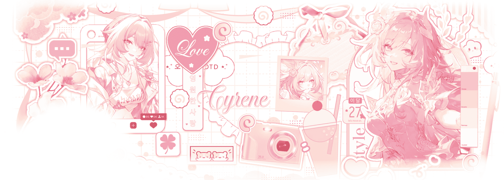

<h2>💮 𝚗𝚊𝚍𝚌𝚑𝚊𝚗'𝚜 𝚐𝚒𝚝𝚑𝚞𝚋 𝚙𝚊𝚐𝚎 ✿</h2>

<i>hayyiee!</i> 
huh coding just for random stuff.... 
when not coding, probably gaming, listening to music, or sleeping. ( ˘ω˘ )

<h3>✿ 𝚜𝚘𝚌𝚒𝚊𝚕𝚜 & 𝚕𝚒𝚗𝚔𝚜 ✿</h3>

lets be friend pls( ˘ω˘ )

<h3>✿ 𝚝𝚎𝚌𝚑 𝚜𝚝𝚊𝚌𝚔 ✿</h3>

languages and tools i regularly play around with:

<h3>✿ 𝚜𝚝𝚊𝚝𝚜 & 𝚊𝚌𝚝𝚒𝚟𝚒𝚝𝚢 ✿</h3> 

my stats:3

<h3>✿ 𝚟𝚒𝚜𝚒𝚝𝚘𝚛𝚜 ✿</h3>

thanks for viewing my readme~ 💮

------------~✧.✿.✧~(♡˙︶˙♡)~✧.✿.✧~------------

